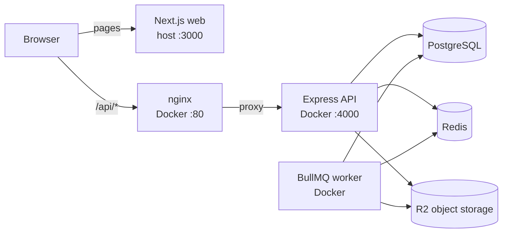

# Perigee marketplace

Perigee is a multi-vendor marketplace monorepo. Customers discover products, manage addresses, save wishlists, and use a cart. Vendors manage products and fulfillment; admins manage marketplace operations and promotions.

## System overview

The web app runs on the host during local development. PostgreSQL, Redis, API, background worker, and nginx run in Docker Compose.



Nginx publishes port 80 and forwards requests to the API container; port 4000 is internal to Compose. See [architecture diagrams](docs/architecture.md) for request and async-work sequences.

## Workspace

- [`apps/web`](apps/web/README.md): Next.js storefront and authenticated vendor/admin UI.
- [`apps/api`](apps/api/README.md): Express API, domain services, and BullMQ worker.
- [`packages/db`](packages/db/README.md): Drizzle schema, PostgreSQL access, and migrations.
- [`docs`](docs/README.md): documentation index; [codebase map](docs/agent-guide.md) routes agents and developers to owning modules, contracts, and checks.
- [`docs/architecture.md`](docs/architecture.md): system boundaries and sequence diagrams.
- [`docs/local-development.md`](docs/local-development.md): Docker workflow, environment, migrations, and troubleshooting.
- [`docs/testing.md`](docs/testing.md): unit, API, typecheck, and browser verification.
- [`docs/domain-flows.md`](docs/domain-flows.md): current customer, vendor, and admin flows plus known gaps.
- [`DESIGN.md`](DESIGN.md): UI tokens and visual rules.
- [`AGENTS.md`](AGENTS.md): engineering and AI-agent rules.

## Requirements

- Node.js `22.x` (declared in root and workspace package manifests; Docker and CI use Node 22).
- pnpm `11.5.3`.
- Docker Desktop or Docker Engine with Compose.

## Run locally

1. Install workspace dependencies: `pnpm install`.
2. Copy `.env.example` to root `.env` and replace placeholders. Do not commit secrets. Set `NEXT_PUBLIC_API_URL=http://localhost/api` for the host web process and `WEB_ORIGIN=http://localhost:3000` for API CORS. Some OAuth and media features require valid credentials.
3. Start PostgreSQL, Redis, API, worker, and nginx: `docker compose up -d`.
4. Apply migrations through the API container: `docker compose exec api pnpm --filter @repo/db migrate`.
5. Start the host web app: `pnpm dev:web`.

Open web at <http://localhost:3000>. API base URL is <http://localhost/api>; Swagger UI is <http://localhost/api/docs/> and OpenAPI JSON is <http://localhost/api/docs.json>.

For API/DB source synchronization during development, use Compose Watch as described in [local development](docs/local-development.md).

## Verification

```sh
pnpm test
pnpm check
pnpm build
```

`pnpm check` runs formatting, lint, and type checks. Package-level commands and database/browser testing notes are in [testing](docs/testing.md).

## Repository invariants

- Web calls API contracts; it does not access the database directly.
- API derives identity and enforces authorization and tenant ownership server-side.
- API endpoint changes include Zod validation and synchronized OpenAPI documentation.
- Database schema changes include reviewed migrations.
- `AGENTS.md` defines repository rules; `DESIGN.md` defines UI tokens.

## External side effects

- PostgreSQL stores marketplace state.
- Redis/BullMQ coordinate bulk-import jobs and progress events.
- R2 stores uploaded media and import files.
- Google OAuth uses an external identity provider.

## Change workflow

Keep changes in their owning package. Run relevant checks, inspect `git status`, and stage only files for the intended change; avoid blanket `git add .` when other work may be present.

## License

ISC
