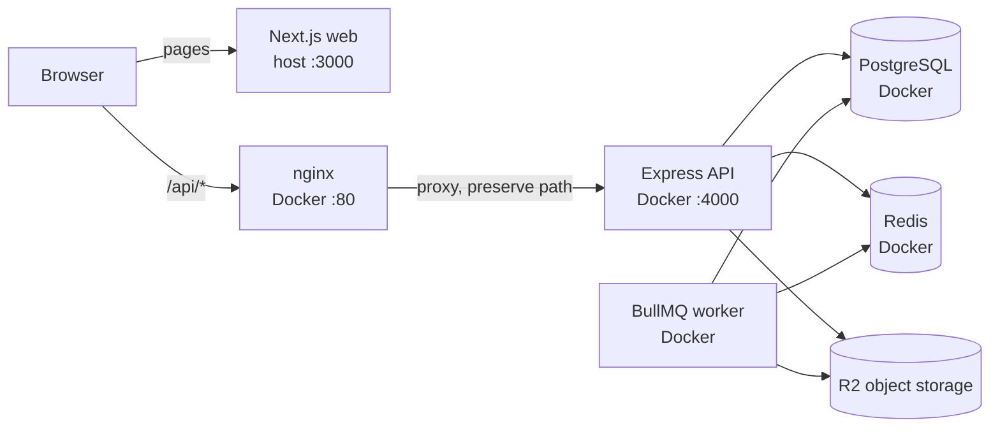
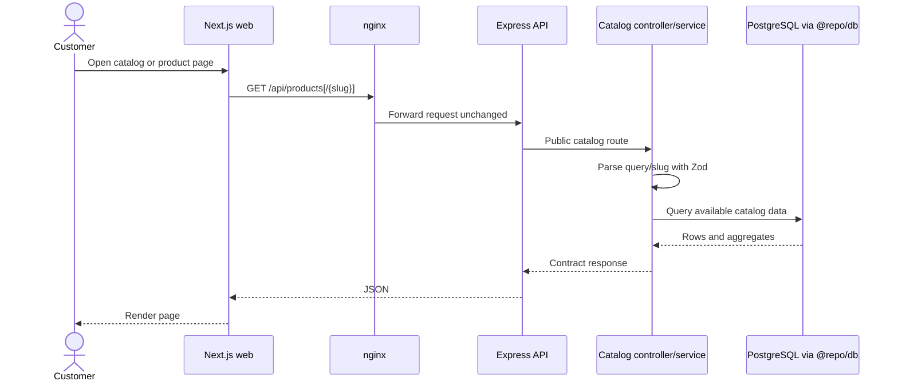
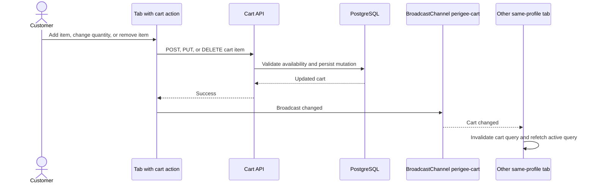
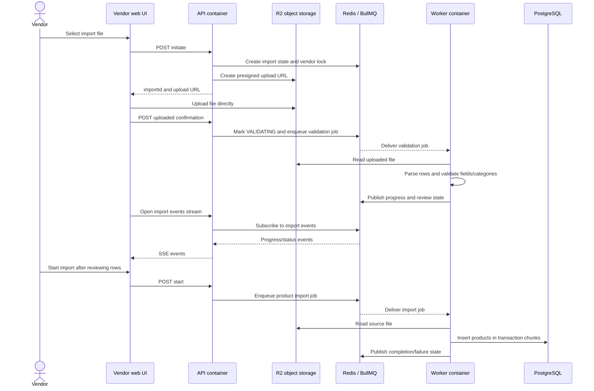
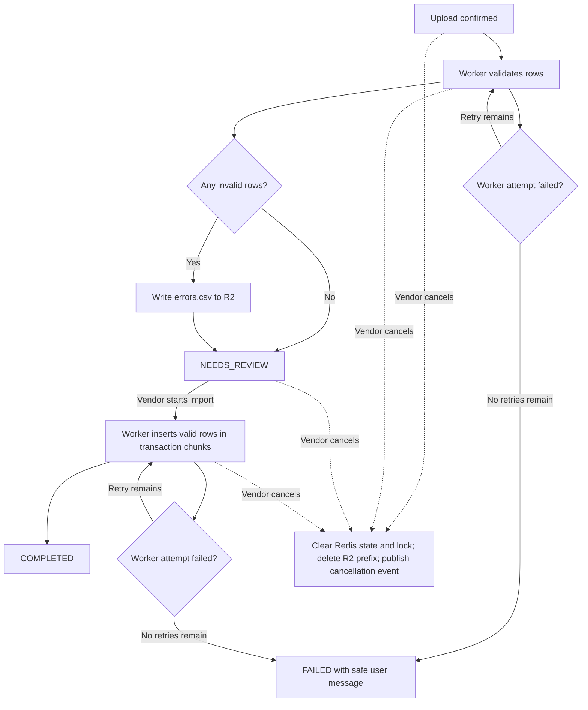

# Architecture

## System boundaries

```text
Browser → apps/web → HTTP/OpenAPI contract → apps/api → @repo/db → PostgreSQL
                                                ↘ Redis / object storage
```

- `apps/web` owns route composition, UI, browser state, and API clients. It must not import database code.
- `apps/api` owns request validation, authentication/authorization, orchestration, and domain behavior.
- `packages/db` owns Drizzle schema, PostgreSQL connection setup, and migrations. It has no application or browser dependencies.
- Redis and object storage are accessed through API-owned infrastructure. Bulk import work is processed by the separate API worker process.

### Local runtime topology



Compose runs PostgreSQL, Redis, API, worker, and nginx. Web runs on the host. Nginx publishes port 80 and proxies requests to the API container on port 4000; the API port is not directly published. Bulk import worker uses Redis/BullMQ and reads/writes object storage and PostgreSQL.

## Request flow

The API mounts feature routers under `/api` in `apps/api/src/routes.ts`. Each feature keeps routes, controllers, schemas, and services together. Routes apply authentication and role/resource middleware; controllers validate input and translate results to HTTP; services perform domain work through `@repo/db`. `apps/api/src/app.ts` owns shared middleware and global error handling.

### Public catalog read



The catalog routes are public in `apps/api/src/features/catalog/catalog.routes.ts`. Request parsing occurs in `catalog.controller.ts`; catalog queries are in `catalog.service.ts`.

### Authentication and tab synchronization

```mermaid
sequenceDiagram
  actor User
  participant Tab as Current browser tab
  participant API as API via nginx
  participant Redis
  participant Google
  participant Other as Other same-profile tabs

  alt Password sign-in
    User->>Tab: Submit credentials
    Tab->>API: POST /api/auth/signin
    API->>API: Validate credentials and create JWT
    API-->>Tab: Set HttpOnly auth_token cookie
    Tab->>Tab: Clear React Query cache and broadcast session-changed
    Tab->>Other: BroadcastChannel message
    Other->>Other: Clear cache and reload
  else Google sign-in
    User->>Tab: Choose Google sign-in
    Tab->>API: GET /api/auth/google
    API->>Redis: Store one-time OAuth state with TTL
    API-->>Tab: Redirect to Google
    Tab->>Google: Authorize
    Google-->>Tab: Redirect to API callback with code and state
    Tab->>API: GET /api/auth/google/callback
    API->>Redis: Validate and consume OAuth state
    API->>Google: Exchange code and verify ID token
    API->>API: Link/create user and create JWT
    API-->>Tab: Set HttpOnly auth_token; redirect with session marker
    Tab->>Tab: Remove marker, clear cache, broadcast session-changed
    Tab->>Other: BroadcastChannel message
    Other->>Other: Clear cache and reload
  else Sign-out
    User->>Tab: Sign out
    Tab->>API: POST /api/auth/signout
    alt API succeeds
      API-->>Tab: Clear HttpOnly auth_token
      Tab->>Tab: Clear cache and broadcast signed-out
      Tab->>Other: BroadcastChannel message
      Other->>Other: Clear cache and redirect to sign-in
    else API fails
      API-->>Tab: Error
      Tab->>Tab: Keep session/cache and show retry message
    end
  end
```

Password sign-in and sign-out are handled by `auth.controller.ts`; Google OAuth uses `google.service.ts` and redirects back with `auth_session_changed=1`. `use-sign-out.ts`, `session-cache.ts`, and `QueryProvider` clear and broadcast cache changes. BroadcastChannel only reaches tabs sharing the same browser profile and origin; separate browser profiles do not share the session event.

### Account creation, verification, and password reset

```mermaid
sequenceDiagram
  actor User
  participant Web as Web auth pages
  participant API as Auth API
  participant Redis
  participant DB as PostgreSQL

  alt Create account
    User->>Web: Submit signup form
    Web->>API: POST /api/auth/signup
    API->>DB: Create unverified customer account with password hash
    API->>Redis: Store hashed email-verification OTP and pending token
    API-->>Web: Set HttpOnly pending-verification cookie; return user
    Note over Web,API: Signup response does not deliver the initial OTP
    Web-->>User: Open verification page
    User->>Web: Request resend after cooldown
    Web->>API: POST /api/auth/send-otp
    API->>Redis: Store new hashed OTP
    API-->>Web: Return OTP in response (current POC behavior)
    User->>Web: Enter OTP
    Web->>API: POST /api/auth/verify-otp
    API->>Redis: Verify OTP and consume it
    API->>DB: Set emailVerifiedAt
    API-->>Web: Verified; clear pending cookie
    Web-->>User: Continue to sign-in
  else Reset password
    User->>Web: Request reset code
    Web->>API: POST /api/auth/send-otp (password_reset)
    API->>Redis: Store hashed reset OTP and pending token
    API-->>Web: Return OTP in response (current POC behavior)
    User->>Web: Submit reset OTP
    Web->>API: POST /api/auth/verify-otp
    API->>Redis: Verify OTP; create short-lived reset token
    API-->>Web: Set HttpOnly reset-password cookie
    User->>Web: Submit new password
    Web->>API: POST /api/auth/reset-password
    API->>DB: Hash and update password
    API->>Redis: Consume reset token
    API-->>Web: Clear reset cookie; return success
  end
```

Signup creates an unverified account and stores an initial OTP, but no email/SMS delivery exists; the signup response also omits that code. The current POC returns codes from `/send-otp` responses, including password-reset requests. This is not a production delivery design. OTPs are stored hashed, expire after five minutes, and allow at most three failed checks. Resend requests have a 60-second cooldown. Password-reset tokens are short-lived and returned to the browser only through an HttpOnly cookie. See `auth.service.ts`, `otp.service.ts`, and the auth web feature hooks.

### Cart updates across tabs



Product detail and cart-page mutations broadcast after success. `QueryProvider` listens and invalidates cart queries in tabs sharing the same profile and origin, including the tab that sent the update. If BroadcastChannel is unavailable, the initiating page invalidates or refreshes its own query. It does not sync separate profiles or browsers. Implementation: `apps/web/lib/cart-sync.ts`, `QueryProvider`, and product-detail/cart-page components.

The API's OpenAPI specification lives in `apps/api/src/docs/openapi.ts` and is served at `/api/docs.json` and `/api/docs/`. Update it with every endpoint or response-contract change.

## Web organization

Follow the direction `app → features → shared → lib`. Routes compose feature UI; feature code owns domain UI, hooks, schemas, and API services; shared components are domain-agnostic. Keep server components by default. Use React Query for server data, Redux only for cross-feature client state, and React Hook Form with Zod for forms. See [apps/web contract](../apps/web/README.md) and [`AGENTS.md`](../AGENTS.md).

## Security and tenant boundaries

Authentication does not imply authorization. Derive identity and role from the server session, then enforce role, resource ownership, and resource state in API middleware/services. Vendor-scoped queries must use the authenticated vendor identity, never a client-supplied vendor ID. These checks require human review; see the security rules in [`AGENTS.md`](../AGENTS.md).

## Persistence and side effects

Drizzle schema is under `packages/db/src/schema`; committed migrations are under `packages/db/drizzle`. Schema changes require a migration. Use transactions when a group of related writes must succeed atomically. Redis queues coordinate asynchronous bulk import; object storage holds uploaded media and import files. See [DB contract](../packages/db/README.md) and [domain flows](domain-flows.md).

### Asynchronous bulk import



This flow is implemented by `bulk-import.routes.ts`, `bulk-import.service.ts`, `src/worker.ts`, and the validate/import processors. The UI uploads bytes directly to R2 using the presigned URL; the API coordinates state, jobs, and SSE updates.

Validation classifies rows as ready or needing attention. When rows need attention, the worker writes an `errors.csv` report to R2 and exposes a temporary download URL. The vendor can review the counts and start import; import creates only valid rows in transaction chunks. Both worker jobs retry up to three times with exponential backoff. Terminal failures set the import state to `FAILED` and publish a safe status message; detailed diagnostics stay in worker logs.

The vendor can cancel an import session, which clears its Redis state and vendor lock, deletes that import's R2 prefix, and publishes a cancellation event. Current implementation does not remove an already queued/running BullMQ job; do not interpret UI cancellation as a guaranteed worker interruption.



Cancellation clears persisted import state rather than storing a `CANCELLED` status. It also does not remove an already queued/running BullMQ job, so the event does not guarantee worker interruption.

## Design source of truth

[`DESIGN.md`](../DESIGN.md) defines visual tokens and component rules. Web implementation lives in `apps/web/app/index.css`, `apps/web/components/ui`, and feature components. Prefer existing shared controls and semantic tokens over one-off styling.
