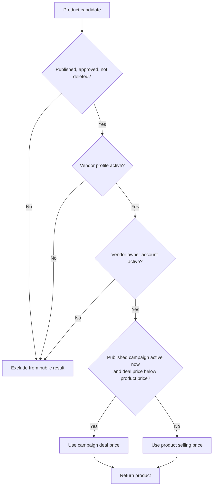
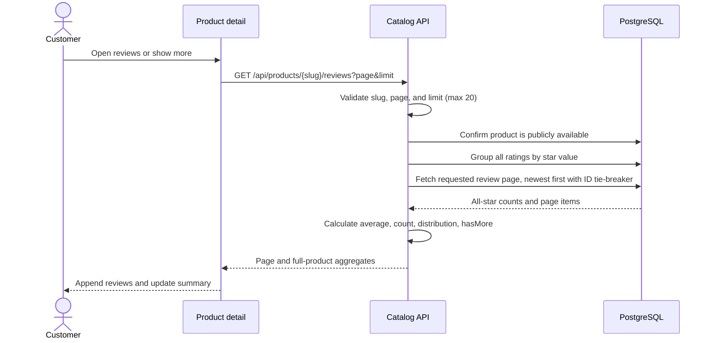
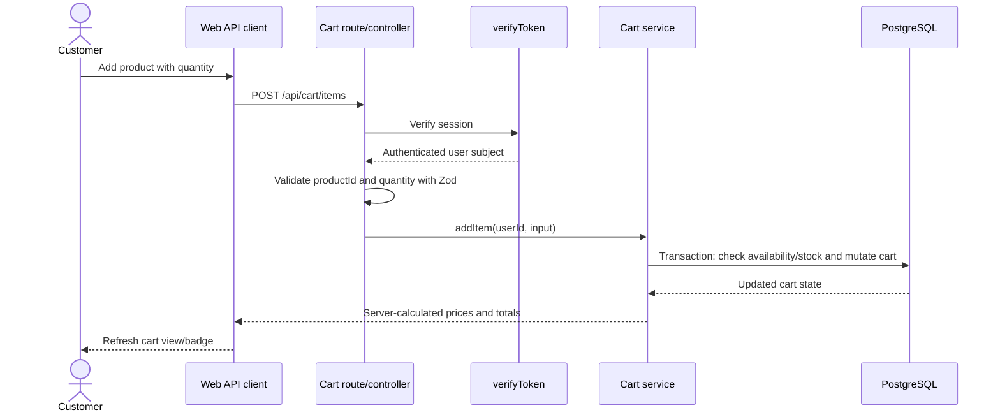
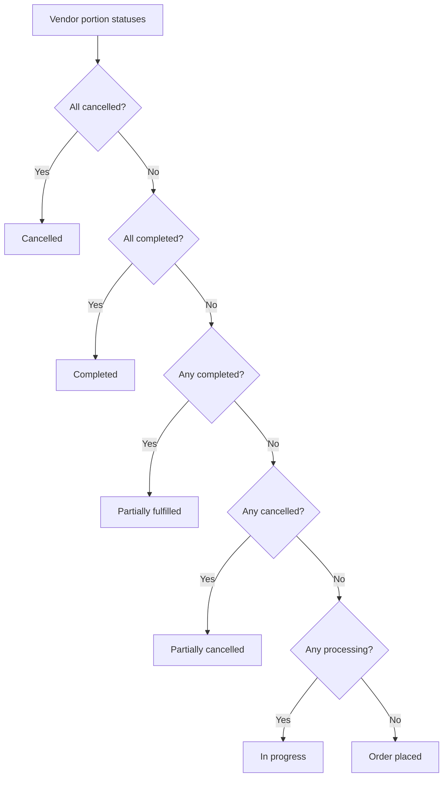
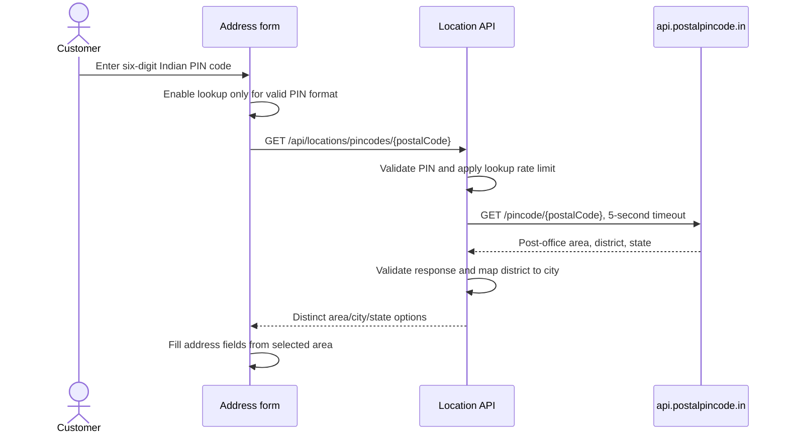
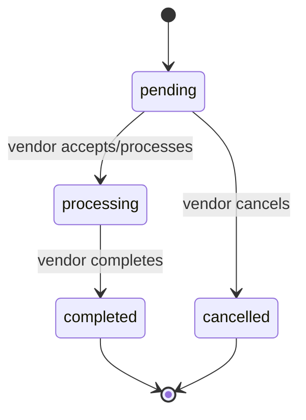
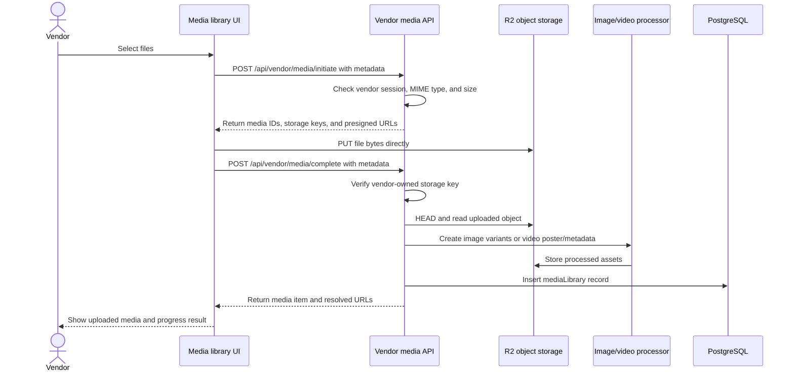
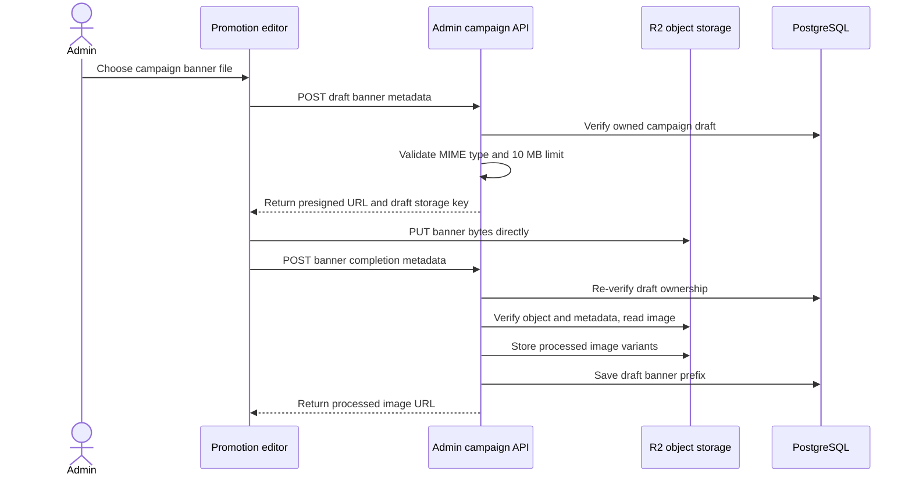
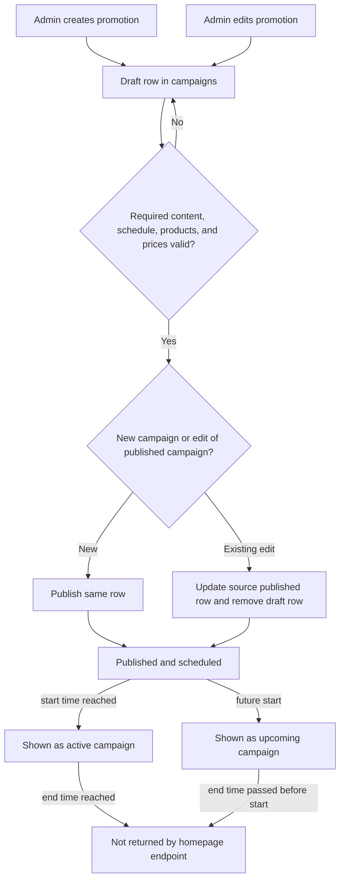

# Domain flows and current scope

This guide separates behavior present in the code from follow-up work discussed for the product. API route registration is in `apps/api/src/routes.ts`; web pages are under `apps/web/app`.

## Customer discovery and purchase

- **Home and navigation:** home categories, featured brands/products, and active/upcoming homepage campaigns come from API-backed services in `apps/web/features/home` and the catalog/merchandising API.
- **Catalog:** product listing, detail, brands, category browsing, and product reviews are public catalog experiences. Current campaign deal prices flow through catalog and cart pricing; see `apps/api/src/shared/pricing/current-product-price.ts`.
- **Account and delivery addresses:** customer account and address features exist. Address ownership is enforced by the API.
- **Wishlist:** authenticated wishlist API and customer page exist.
- **Cart:** cart API requires an authenticated session. Cart totals are calculated server-side; cart does not reserve stock.
- **Checkout and customer order history:** authenticated checkout review, order placement with persisted idempotency keys, order history/detail, and whole-order cancellation are implemented by the customer API and `/checkout` and `/orders` pages. The design record documents the concurrency and retry rules.
- **Review submission:** product review reading and aggregation exist. Customer review submission remains deferred.

### Public catalog visibility and effective price



These visibility predicates apply to public catalog data and review access. The effective price expression is shared by product responses, price sorting/ranges, and cart totals. `currentProductPriceSql` uses the most recently started eligible active campaign; otherwise it falls back to `products.price`.

### Product review pagination and aggregates



Aggregates include rating-only reviews and use every review, independent of page. Implementation lives in `getProductReviews` and `productReviewsQuerySchema` under the catalog feature.

### Add an item to cart



Cart routes apply `verifyToken` in `apps/api/src/features/cart/cart.routes.ts`. The controller derives the user ID from the verified session; cart writes run in transactions in `cart.service.ts`.

### Checkout placement and safe retry

```mermaid
sequenceDiagram
  actor Customer
  participant Web as Checkout page
  participant API as Customer order API
  participant DB as PostgreSQL

  Customer->>Web: Review cart and select saved address
  Web->>API: GET checkout review with address ID
  API->>DB: Read owned IN address, cart, current prices, and stock
  DB-->>API: Review data
  API-->>Web: Lines, totals, stock, and expected prices

  Customer->>Web: Place order
  Web->>Web: Persist UUID key and exact request in localStorage
  Web->>API: POST order with Idempotency-Key
  API->>DB: Begin transaction; lock active user, then cart
  API->>DB: Look up user + key before reading cart

  alt Same key and same fingerprint already placed
    DB-->>API: Existing order
    API-->>Web: Return existing order; do not change stock or cart
  else New key
    API->>DB: Lock products by ID; recheck availability, price, stock, address
    alt Any line changed or unavailable
      API-->>Web: Conflict with affected lines and current values
      Web-->>Customer: Keep cart; refresh review; ask for confirmation
    else All lines valid
      API->>DB: Create order, vendor portions, and snapshots
      API->>DB: Decrement stock and remove submitted cart lines
      API->>DB: Commit
      API-->>Web: Order confirmation
    end
  else Same key, different fingerprint
    API-->>Web: Conflict; do not create another order
  end
```

On timeout or network failure, the web app keeps the exact request and key and offers an explicit retry. It does not create a new key until the customer reviews changed order details. The API computes the fingerprint; it does not accept one from the browser. Product locks coordinate checkout with campaign price changes. Database changes and cart cleanup commit together or roll back together.

### Customer cancellation and vendor status aggregation

```mermaid
sequenceDiagram
  actor Customer
  participant CustomerWeb as Customer order page
  participant API as Order API
  participant DB as PostgreSQL
  actor Vendor
  participant VendorWeb as Vendor order page

  Customer->>CustomerWeb: Cancel whole order
  CustomerWeb->>API: POST customer order cancellation
  API->>DB: Lock parent order; reread all vendor portions
  alt Any portion is completed
    API-->>CustomerWeb: Reject cancellation; show current order status
  else No portion is completed
    API->>DB: Cancel remaining pending/processing portions atomically
    API->>DB: Restore stock for portions changed to cancelled
    API->>DB: Recalculate parent status; commit
    API-->>CustomerWeb: Return customer-safe order status
  end

  Vendor->>VendorWeb: Change vendor portion status
  VendorWeb->>API: POST vendor status update
  API->>DB: Lock parent order; reread vendor portions
  API->>DB: Validate and conditionally apply transition
  API->>DB: Restore stock only if pending portion changed to cancelled
  API->>DB: Recalculate parent status; commit
  API-->>VendorWeb: Return updated vendor order
```

The transaction lock order is parent order first, then vendor portions. Customer cancellation is all-or-nothing and becomes unavailable when any portion is `completed`. Vendors may cancel only `pending` portions; `processing` portions may only become `completed`. Stock restoration applies only to portions actually transitioned to `cancelled`, preventing duplicate restoration on retries.

Customer-facing status is derived from all vendor portions; customers do not receive vendor order IDs or per-vendor actions:



### Indian PIN-code lookup for address forms



The lookup endpoint is public for guest delivery-location selection. Saving a customer address is a separate authenticated, ownership-checked flow; `customer-address.service.ts` also verifies that the PIN exists before persistence.

## Vendor operations

- Vendors manage profile, products, product media, and bulk imports through authenticated vendor routes.
- Vendor order list/detail/status flows exist in `apps/api/src/features/vendor/order.*` and the vendor app routes. Fulfillment statuses are `pending`, `processing`, `completed`, and `cancelled`; allowed transitions are defined by `getAllowedOrderActions`.
- Vendor order updates recalculate the parent order status. Order management routes remain available to suspended vendors so existing commitments can be fulfilled; product management requires an active vendor.
- Carrier integration, shipment tracking, and customer delivery notifications are not represented by the current vendor order status contract.

### Vendor fulfillment state flow



Each vendor status change locks the parent order first, verifies vendor ownership, rereads the portion, and applies a conditional transition in one transaction. Vendor cancellation is pending-only; stock is restored exactly once. Existing transition logic is in `getAllowedOrderActions` and `updateVendorOrderStatus` in `apps/api/src/features/vendor/order.service.ts`.

### Vendor media-library upload



`apps/web/features/media/services/media.service.ts` sends metadata to the API and uploads bytes directly to R2. `completeMediaUpload` verifies ownership and uploaded object metadata, processes the file, then stores the library record. Failed processing cleans up the asset prefix.

## Admin operations and merchandising

- Admin routes cover administration, categories, vendors/customers, products, orders, and merchandising.
- Campaigns support draft editing, publishing, scheduling, product deal prices, banner media, and homepage listing. Public homepage campaign data is provided by `/api/merchandising/homepage`.
- Vendor media management is under `/api/vendor/media`. Admin media currently exposes a campaign media catalog; campaign banner upload operations are campaign-scoped. A broader admin media-library management workflow is separate follow-up work.

### Campaign banner upload

Campaign banner upload has its own draft-scoped flow; files are not inserted into the vendor media library.



The flow is implemented by `promotion-editor.tsx`, `admin.service.ts`, and `merchandising.service.ts`. It uses direct-to-storage transfer but stores processed campaign draft assets separately from reusable vendor media.

### Campaign draft and publication flow



Drafts and published campaigns share `campaigns`; an edit draft points to its published source through `sourceCampaignId`. The homepage endpoint orders by campaign position and start time, then returns active campaigns and up to three upcoming campaigns. Publishing and schedule selection are implemented in `merchandising.service.ts`.

## Follow-up sequence discussed

1. Define shipment/tracking information and customer delivery notifications before adding shipping statuses.
2. Add customer review submission and decide purchase-verification rules.
3. Extend admin media-library management if needed beyond current campaign media selection/upload.

Treat this list as planning context, not an API contract. Update it when implementation scope changes.
